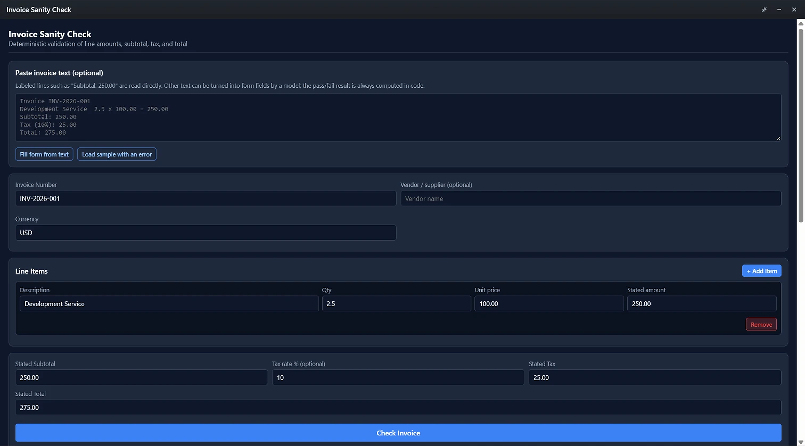
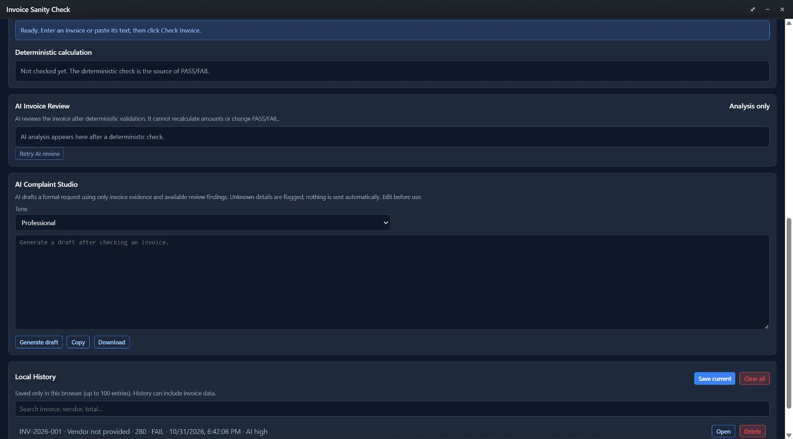
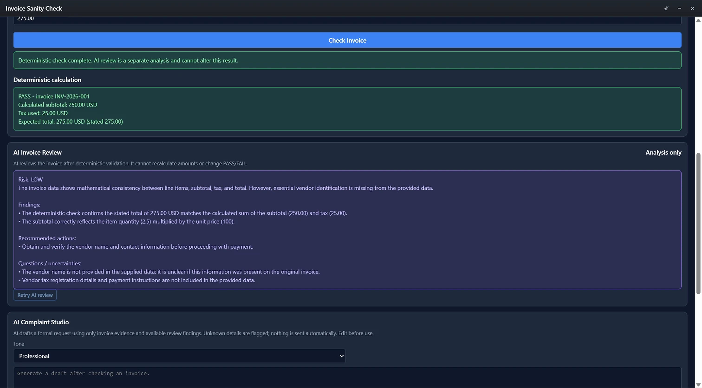
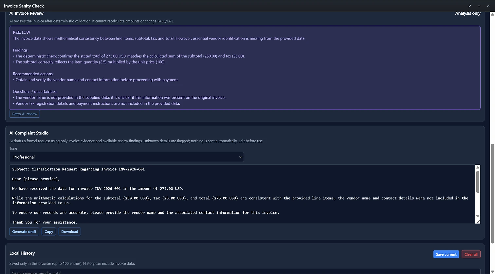

# Invoice Sanity Check - Anna AI App

A deterministic invoice validation mini-app and Executa built for the Anna AI App Builder Program. It verifies line-item arithmetic, calculates exact sub-totals, applies tax, and cross-checks totals using Python's decimal.Decimal engine to eliminate floating-point discrepancies. The app also provides AI-assisted invoice review, AI-assisted complaint drafting, and local history - all clearly separated from the deterministic financial result.

## Features
- Exact Currency Arithmetic: Powered by Python Decimal with ROUND_HALF_UP precision.
- Dynamic Line Items: Add/remove multiple invoice items with descriptions, quantities, unit prices, and stated amounts.
- Deterministic PASS/FAIL: check_invoice (Executa Python) is the only source of pass/fail. The model never decides the result.
- AI Invoice Review: Optional LLM review that explains the deterministic result and flags questions/uncertainties. It cannot recalculate amounts or override PASS/FAIL.
- AI Complaint Studio: Optional LLM draft of an editable clarification/complaint request. Monetary figures and PASS/FAIL are preserved from the deterministic result.
- Local History: Save, search, reopen, and clear up to 100 invoices in the browser's localStorage.
- Anna App Harness Compatible: Communicates via standard JSON-RPC over the Anna Browser SDK (@anna-ai/app-runtime).
- Comprehensive Sanity Rules:
  - item.amount == item.quantity * item.unit_price
  - subtotal == sum(items.amount) (when a stated subtotal is provided)
  - total == subtotal + tax
  - Non-empty invoice numbers and non-negative financial values.
  - Optional tax rate (percent) applied to the calculated subtotal.

## Deterministic vs. AI
- Deterministic (authoritative): check_invoice runs in the bundled Executa (Python Decimal). It returns valid (PASS/FAIL), issues, calculated_subtotal, calculated_tax, expected_total, and stated_total. These values are never recalculated or overridden by the model.
- AI (advisory only): anna.llm.complete is used for (a) extracting fields from pasted invoice text, (b) explaining a deterministic result, and (c) drafting a complaint. AI output is labeled as unverified commentary and is subject to stale-response guards. If the model service is unavailable, the app reports an error; it does not fabricate a successful AI response.
- Invoice text is treated as data, not instructions.

## Project Structure
```text
invoice-sanity-check/
+-- manifest.json          # App manifest: UI bundle, views, host_api ACL, bundled executa refs
+-- app.json               # Listing metadata (description, logo, screenshots) + bundled_executas
+-- assets/logo.svg        # Store logo
+-- screenshots/           # Store listing screenshots (01-invoice-form.png, 02-pass-result.png, 03-fail-result.png)
+-- .github/workflows/
|   +-- build-executa.yml  # PyInstaller per-platform build -> GitHub Release assets
+-- bundle/
|   +-- index.html         # SPA entry; loads anna-tool-ids.js then app.js
|   +-- app.js             # SPA: manual entry, paste/import, deterministic check, AI review, complaint, history
|   +-- anna-tool-ids.js   # Auto-generated sidecar (gitignored); maps handle -> server-minted tool_id
+-- executas/
|   +-- invoice-sanity-check/
|       +-- executa.json              # Dev identity + distribution (binary URLs)
|       +-- pyproject.toml            # name + [project.scripts] key == minted tool_id
|       +-- uv.lock
|       +-- invoice_sanity_check_plugin.py   # stdio JSON-RPC tool plugin (describe/invoke)
|       +-- manifest.json             # Executa manifest (shipped)
+-- tests/
|   +-- test_invoice_sanity_check_plugin.py   # Executa logic + distribution + protocol tests
|   +-- test_evidence_grounding.mjs           # Static prompt/evidence-grounding regression tests
+-- scripts/
|   +-- verify_executa.py     # Archive smoke test (init/describe/health/ping/PASS/FAIL/recovery/EOF)
+-- acltest.mjs            # Regression check: bundle tool id vs manifest ACL
+-- README.md
```

## How the tool id is wired

The frontend never hardcodes a tool id. anna-app apps publish and anna-app dev resolve the bundled invoice-sanity-check handle declared in manifest.json to the server-minted tool_id and write bundle/anna-tool-ids.js (window.__ANNA_TOOL_IDS__). bundle/app.js reads that mapping at runtime, and bundle/index.html loads the sidecar before app.js.

The registry identity is account-specific. The migrated account uses tool-alireza-invoice-sanity-check-jrqmux6d. Never replace the frontend mapping with the legacy executable name.
## How the tool is installed on an Agent

executas/invoice-sanity-check/executa.json carries a distribution block. Without one the Executa is dev-only. The active profile is binary: the Agent downloads a self-contained PyInstaller binary per os/arch from the GitHub Release, verified by sha256. .github/workflows/build-executa.yml builds and attaches those assets.

The local profile is kept for the dev loop. acltest.mjs fails if the active profile ever regresses to local/dev-only.

Before submitting a release, run python -m pytest tests/test_invoice_sanity_check_plugin.py. The distribution regression test checks that every declared URL uses the current tool id, version tag, platform archive name, and executable entrypoint.
## Executa protocol notes
describe must return a top-level name and parameters as a list of name/type/description/required entries (not a JSON-Schema object). The archive-root manifest.json in each release asset uses the same name. tests/ asserts this, and the CI smoke test checks it against the built binary.
## Local History
- Entries are stored in the browser's localStorage under invoice-sanity-check.history.v1 (up to 100 entries).
- Saved data includes the invoice, deterministic result, AI review (if any), and complaint draft/tone.
- History is device-local and best-effort; it is not a secure or shared store.
- Because invoice data is sent to Anna's model service when AI review or complaint drafting is used, do not treat history as fully local/private in those flows.

## AI Unavailability / Error Behavior
- If anna.llm.complete is unavailable, AI review/complaint drafting reports an error and leaves the deterministic result intact.
- Malformed model JSON is rejected with an explicit error; the deterministic result remains available.
- Stale responses (after an invoice edit or a newer request) are discarded; the UI is not overwritten by outdated AI output.
- AI output never changes invoice fields or the PASS/FAIL result.

## Screenshots

Screenshots of the running app (without browser chrome or taskbars):






## Validation and publication

Use this repository root for future work. Previous local identity files are backed up under the ignored .review/previous-account/ directory.

Install the pinned developer tooling with npm ci, then run:

npm run validate
npm run test:acl
python -m pytest -q tests
node tests/test_evidence_grounding.mjs
python scripts/verify_executa.py path/to/platform-release.tar.gz --version 0.3.0

The executable verifier unpacks a fresh archive, performs initialize/describe, health and ping, checks passing and failing invoices, verifies error recovery in the same long-running process, and checks clean shutdown on stdin EOF. CI runs it against the packaged artifact on each native platform before uploading it. This is separate from the required final test: install a fresh draft on an Anna Cloud Agent, open its UI, and run the manual-entry and paste-text flows there.

The installed executable and app UI have separate version histories. When only the UI changes, bump the app version; rebuild and bump the Executa only when its source or package changes. Publish/cut after the referenced assets are available.
